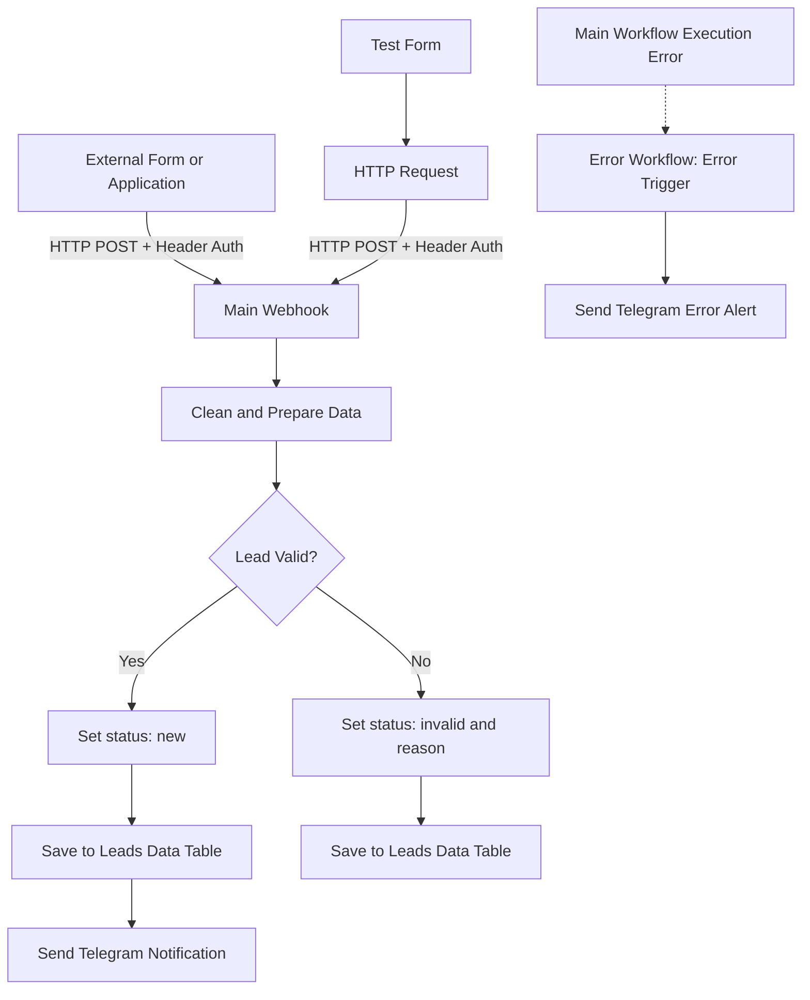

# Lead Intake Automation with n8n

An educational lead-intake automation built with **n8n** for a simulated dental clinic. The project receives lead submissions through an authenticated Webhook, cleans and validates the submitted data, stores each submission in an n8n Data Table, and sends a Telegram notification for valid leads.

The project also includes a dedicated error-handling workflow and a form-based workflow for submitting test data.

> **Project status:** Completed educational prototype. It demonstrates a basic lead-intake process; it is not a complete CRM or a production-ready patient-management system.

## Table of Contents

- [Problem Statement](#problem-statement)
- [Features](#features)
- [Architecture](#architecture)
- [Workflows](#workflows)
- [Data Model](#data-model)
- [Validation and Data Handling](#validation-and-data-handling)
- [Error Handling](#error-handling)
- [Testing](#testing)
- [Requirements](#requirements)
- [Setup](#setup)
- [Security Notes](#security-notes)
- [Current Limitations](#current-limitations)
- [Repository Structure](#repository-structure)
- [Demo](#demo)

## Problem Statement

A small dental clinic needs a simple way to receive appointment or service inquiries, keep the submitted information organized, and notify an administrator when a valid lead arrives.

Manually reviewing every submission and forwarding notifications can take time. This project automates the basic intake process while keeping valid and invalid submissions available for review.

## Features

- Receive lead data through an HTTP `POST` Webhook.
- Protect the Webhook with Header Authentication.
- Normalize and prepare incoming fields.
- Validate the required lead information.
- Store valid and invalid submissions in an n8n Data Table.
- Send a Telegram notification for valid leads.
- Use a separate Error Workflow to notify the administrator about unhandled workflow errors.
- Use a form-based test workflow to submit sample leads without manually composing HTTP requests.
- Retry failed Telegram notification attempts on the main notification node. With n8n defaults, Retry On Fail uses three total attempts (the initial attempt plus up to two retries), with a one-second wait between attempts.

## Architecture



## Workflows

### 1. Lead Intake - Main Workflow

The main workflow handles incoming lead submissions.

1. **Webhook:** Receives a JSON payload through an authenticated HTTP `POST` request. The Webhook responds immediately after receiving the request; processing continues in the workflow.
2. **Edit Fields:** Trims text fields, converts the email address to lowercase, normalizes the phone number by removing non-digit characters, and adds a creation timestamp.
3. **IF:** Checks whether the name is present, the email contains `@`, and the normalized phone number contains at least seven digits.
4. **Valid path:** Marks the submission as `new`, inserts it into the `Leads` Data Table, and sends a Telegram notification.
5. **Invalid path:** Marks the submission as `invalid`, records a reason, and inserts it into the same Data Table. No new-lead Telegram notification is sent for this path.

The Telegram notification includes the lead's name, phone number, requested service, and email address. The free-text message submitted by the user is stored in the Data Table but is intentionally not included in the Telegram notification.

### 2. Lead Intake - Error Workflow

The Error Workflow starts with an **Error Trigger** and sends a Telegram alert when the main workflow encounters an unhandled execution error.

The alert is intended to help the administrator identify and investigate failed executions. Normal validation outcomes, such as a missing email, are handled by the main workflow and do not count as workflow execution errors.

### 3. Test - Send Lead via Form

This workflow provides a simple n8n form with fields for name, email, phone, service, and message.

After submission, an **HTTP Request** node sends the form data as JSON to the main workflow's Webhook, using the same Header Auth credential. The form fields are optional so that valid, incomplete, and invalid input scenarios can be tested.

## Data Model

The main workflow stores submissions in an n8n Data Table named `Leads` with the following columns:

| Column | Purpose |
|---|---|
| `created_at` | Timestamp when the submission is processed |
| `name` | Lead's name |
| `email` | Lead's email address |
| `phone` | Normalized phone number |
| `service` | Requested dental service |
| `message` | Additional message submitted through the form |
| `status` | `new` for valid submissions or `invalid` for invalid submissions |
| `reason` | Explanation recorded for an invalid submission; empty for valid submissions |

## Validation and Data Handling

The current workflow applies basic validation intended for this educational project:

- The name must not be empty.
- The email must contain `@`.
- The normalized phone number must contain at least seven digits.
- Text fields are trimmed; the email is converted to lowercase.
- Non-digit characters are removed from the phone field before the minimum-length check.

These checks are intentionally lightweight. They do not verify that an email inbox or phone number actually exists, nor do they establish ownership of either contact method.

## Error Handling

The main workflow's Telegram notification node has Retry On Fail enabled. In the exported JSON, `maxTries` and `waitBetweenTries` are not explicitly set, so n8n defaults apply: three total attempts (the initial attempt plus up to two retries) and a one-second wait between attempts. If the main workflow ultimately fails with an unhandled error, the assigned Error Workflow sends a separate Telegram error alert.

The Error Workflow must be selected in the main workflow's settings. The Telegram credentials and destination Chat ID must also be configured in the relevant Telegram nodes.

## Testing

The project was tested with the following scenarios:

| Test scenario | Expected result | Result |
|---|---|---|
| Valid lead submission | Save with `new` status and send a Telegram notification | Passed |
| Empty email | Save with `invalid` status; do not send a new-lead notification | Passed |
| Empty name | Save as invalid | Passed |
| Malformed email input | Save as invalid | Passed |
| Phone number below the minimum length | Save as invalid | Passed |
| Request without the required Webhook authentication header | Reject the request before normal processing | Passed |
| Telegram send failure | Retry the notification and trigger the configured error-handling path after the failure remains unresolved | Passed |
| Normal submission after restoring Telegram settings | Process the lead and send a notification successfully | Passed |

## Requirements

- An n8n instance with the Webhook, Edit Fields, IF, Data Table, Telegram, Form Trigger, HTTP Request, and Error Trigger nodes available.
- A Telegram bot and a Telegram chat where notifications can be received.
- A Header Auth credential for the main Webhook.
- An n8n Data Table named `Leads` with the columns listed above.

## Setup

1. Import the three workflow JSON files from the `workflows/` directory into your n8n instance.
2. Create the `Leads` Data Table and add the columns listed in the [Data Model](#data-model) section.
3. Create a **Header Auth** credential in n8n and assign it to the main Webhook.
4. Select the same Header Auth credential in the test workflow's HTTP Request node.
5. Create or select a **Telegram API** credential in each Telegram node and configure the destination Chat ID.
6. In the main workflow's settings, select **Lead Intake - Error Workflow** as its Error Workflow.
7. In the test workflow's HTTP Request node, set the main Webhook URL for the environment being tested. Use the Test URL while running a test execution, or the Production URL when the main workflow is active/published.
8. Save and activate/publish the workflows as appropriate for your n8n version and environment.
9. Open the test form, submit sample data, and inspect the main workflow execution, the `Leads` Data Table, and Telegram notifications.

> Exact menu labels can vary between n8n versions. Configure credentials inside n8n rather than embedding secrets in exported workflow files.

## Security Notes

- Do not commit Telegram bot tokens, Header Auth secrets, private Chat IDs, or other credentials to GitHub.
- Before committing exported workflows, inspect the JSON files and remove or replace environment-specific values such as private Webhook URLs, Chat IDs, and credential references where appropriate.
- Do not put the Webhook secret in browser-side HTML or JavaScript. A secret embedded in client-side code can be viewed by visitors. The included test workflow keeps the authenticated request on the n8n side.
- Use synthetic sample data in screenshots, demonstrations, and repository examples. Do not publish real customer or patient information.
- The free-text message is not sent to Telegram, which helps avoid distributing potentially sensitive details through a notification channel.

## Current Limitations

This project intentionally focuses on the core lead-intake flow. The following capabilities are not implemented:

- Duplicate-submission detection or idempotency handling.
- Rate limiting or advanced spam prevention.
- CRM functionality or customer history management.
- Verification of email address or phone number ownership.
- A production-grade patient-data security and compliance design.

These are possible future enhancements, not part of the current project scope.

## Repository Structure

```text
n8n-lead-intake-automation/
├── README.md
├── workflows/
│   ├── 01-main-workflow.json
│   ├── 02-error-workflow.json
│   └── 03-test-workflow.json
└── screenshots/
    ├── main-workflow.png
    ├── error-workflow.png
    ├── test-form.png
    ├──telegram-notification1.png
    └── telegram-notification2.png
```

## Demo

A short demonstration video will be added here.

- **Demo video:** `Coming soon`
